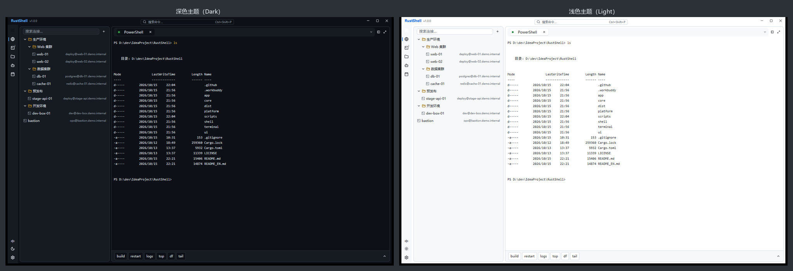
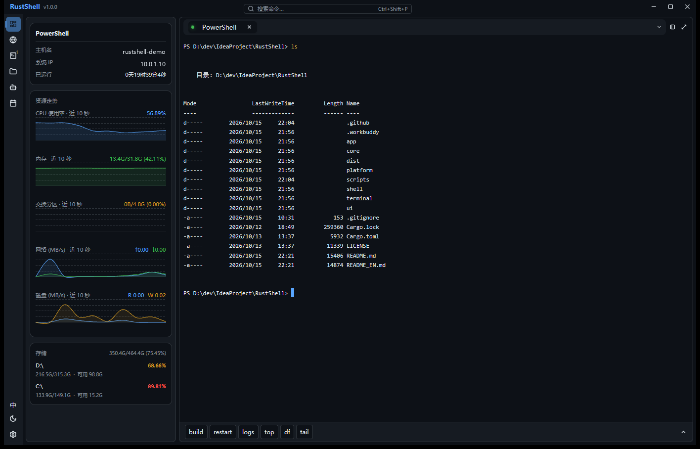
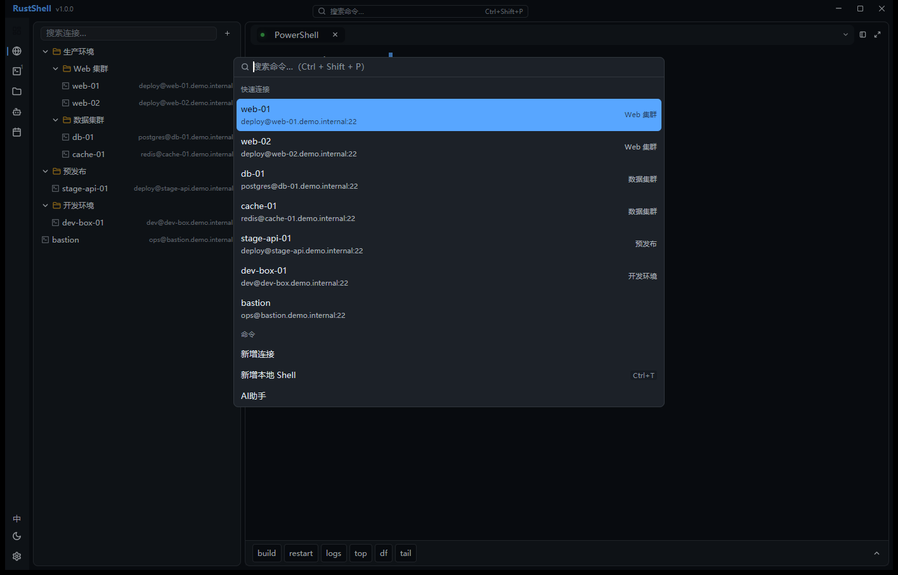
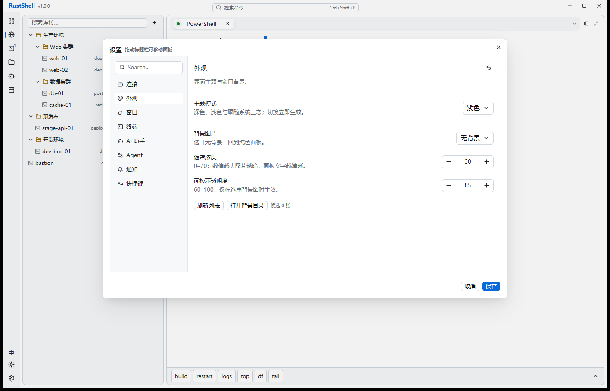

<div align="center">

# RustShell

**Rust + GPUI 打造的跨平台终端 / SSH / SFTP 一体化桌面客户端**

[English](./README_EN.md) · 简体中文 · [快速开始](#快速开始) · [架构](#架构) · [贡献](#贡献)

[](https://github.com/Yuxxxy/RustShell/actions/workflows/ci.yml)
[](https://github.com/Yuxxxy/RustShell/actions/workflows/release.yml)
[](https://www.rust-lang.org/)
[](./LICENSE)
[](https://github.com/Yuxxxy/RustShell)


</div>

---

## 界面预览

> 以下为真实运行截图（Windows 11）。截图中的连接、主机名与 IP 均为演示数据。
> 徽章为仓库内自托管 SVG，不依赖任何外部图床。

**深浅主题**：Dark / Light / 跟随系统三态，Token 驱动的全局换肤



**系统监控概览**：CPU / 内存 / 交换分区 / 网络 / 磁盘 1 s 采样，自绘 AreaChart 走势力



**命令面板与设置**

<p align="center">
  
  
</p>

<p align="center"><sub>左：命令面板（<code>Ctrl+Shift+P</code>），快速连接与命令一体检索 · 右：设置 → 外观（主题三态 / 背景图 / 面板不透明度）</sub></p>

---

## RustShell 是什么

RustShell 是一个用 Rust + GPUI 编写的**跨平台桌面终端与服务器管理工具**：本地终端、SSH 会话、
  
SFTP 文件传输、快捷指令、系统监控与可选的 AI 助手，全部在一个原生窗口里完成。

它不使用 Electron / WebView，终端渲染由本仓自有的引擎 **`rustshell-terminal`** 承担
  
（`alacritty_terminal` 做 VTE 解析 + GPUI 做 GPU 绘制），因此启动与滚动开销都保持在原生级别
  
（release 热启动实测 144–152 ms）。

> **AI 助手**不是一个外部依赖，而是仓库自研的、带安全闸的 **domain-specific agent harness**：
>   
> `runner` 编排 control loop、`ai.rs` 负责 LLM 通信、`agent/` 负责工具定义与安全 / 预算裁决，
>   
> 前端（`ui/`）仅通过 `AgentUiEvent` 通道消费进度。
>
> **状态**：早期阶段，持续开发中。**当前依赖的 `gpui-pre-platform` 0.3.4 仅提供 Windows 后端**，
> 因此 Windows 11 是当前唯一实测可运行的平台；macOS / Linux 的打包脚本已就绪，但需上游先提供
> 对应平台后端。1.0 之前 API / UX 仍可能变化。

### 特性

| 分类        | 能力                                                                                                          |
| --------- | ----------------------------------------------------------------------------------------------------------- |
| **本地终端**  | ConPTY / PTY 会话，多 Tab、分屏（右 / 下，可选共享会话或新会话）、Tab 右键菜单断开与原地重连，异步启动不冻结 UI                                       |
| **终端引擎**  | 完整 ANSI 转义序列、256 色 / 24 位真彩、粗斜体 / 下划线变体 / 反显、三种光标形状与闪烁、bracketed paste、OSC 52 剪贴板、GBK / Big5 / Shift_JIS 转码 |
| **选择与搜索** | 鼠标划选 / 双击选词 / 三击选行（选中即复制）、滚轮回看历史、`Ctrl+F` 正则搜索与命中跳转（含滚回区，自动回绕）                                              |
| **SSH**   | `russh` 会话（密码 / 私钥）、`known_hosts` OpenSSH 格式校验与首次信任指纹确认、全链路超时（握手 20s / 认证与 PTY 各 15s）不挂死                    |
| **SFTP**  | 远端目录浏览、上传 / 下载、新建目录、重命名 / 删除、传输队列与进度，与指标服务共享同一连接                                                            |
| **连接管理**  | 树形分组、双击连接、右键菜单、命令面板快速连接                                                                                     |
| **快捷指令**  | 分组管理、拖拽排序、上移 / 下移、多行脚本逐行发送、风险拦截与确认卡片、置顶槽位                                                                   |
| **系统监控**  | 概览面板 CPU / MEM / SWP / 网络 / 磁盘 1s 采样，300 点环形缓冲；悬停或展开显示走势（自绘 AreaChart），>85% 转红告警，窗口失焦自动降频至 5s |
| **AI 助手** | OpenAI 兼容端点（含本地网关 / Ollama）、SSE 流式渲染、L1 问答 + L2 命令生成、三级风险分级与拦截、auto-approve 白名单、多 Provider 降级               |
| **外观**    | Dark / Light / 跟随系统三态主题、跟随系统的窗口装饰、中英双语界面                                                                    |
| **键位**    | 设置面板内录制式重绑定（即时生效）、冲突检测、JSON 导入导出                                                                            |
| **可观测性**  | 运行日志（5MB × 3 滚动 + panic 落盘）、AI 与快捷命令审计日志（JSON Lines）、一键导出诊断包                                                |

### 安全设计（AI 与命令执行）

AI 是**可选**能力，默认不配置任何 Provider 即完全离线。开启后：

- **上送范围可控**：仅上送用户输入 + 当前绑定服务器元数据 + 当前终端最近 N 行输出（默认 200 行，可调 10–2000）；密码、私钥、其他会话内容**不**上送
- **发送前脱敏**：password / token 赋值形态、`sk-` / `ghp_` / `AKIA` 密钥字面量、IP 正则过滤，≤8 KiB 截断
- **密钥加密落盘**：Windows DPAPI、macOS Keychain、Linux Secret Service（`keyring`），JSON 只存引用
- **风险三级模型**：查询类直跑 / 状态变更类确认 / 破坏类（`mkfs`、`dd`、`rm -rf /`、fork 炸弹等）直接拦截且不可加入白名单
- **全量审计**：`agent-audit.log` 记录时间、类型、风险级、命令与是否执行，**拦截行为同样留痕**

---

## 快速开始

### 方式一：下载预构建包

在 [Releases](https://github.com/Yuxxxy/RustShell/releases) 或
  
[Release Build](https://github.com/Yuxxxy/RustShell/actions/workflows/release.yml) 的 Artifacts 中取包：

- Windows：`rustshell-<version>-windows-x64.zip`（绿色版，解压即用）与 `rustshell_<version>_x64-setup.exe`（NSIS 安装包，免管理员安装到当前用户）
- macOS：`rustshell-<version>-macos-x64-arm64.zip`（通用二进制，Intel / Apple Silicon 均可运行）

### 方式二：从源码构建

前置依赖：

- **Rust** stable ≥ 1.85（`terminal/` 使用 edition 2024）
- **Windows**：Visual Studio 2022 Build Tools（MSVC 链接器与 `rc.exe`）
- **macOS**：Xcode Command Line Tools（`xcode-select --install`）
- **Linux**：构建 GPUI 所需的系统库（X11 / Wayland + fontconfig 等，按发行版安装）

```bash
git clone https://github.com/Yuxxxy/RustShell.git
cd RustShell

# 开发构建
cargo build -p rustshell
cargo run -p rustshell

# Release 构建（thin LTO + strip，约 28 MB）
cargo build --release -p rustshell
```

打包分发（脚本位于 [`scripts/`](./scripts)，从仓库根执行）：

```bash
# Windows：NSIS 安装包 -> dist/packager/
./scripts/package-windows.sh

# macOS：universal binary + zip -> dist/
./scripts/build-macos.sh
```

> 两个脚本都使用 `cd "$(dirname "$0")/.."` 回到仓库根，因此在任意工作目录下调用均可。
>   
> Windows 安装包的产物位于 **`dist/packager/`**（`app/Cargo.toml` 中 `out-dir = "../dist/packager"`，
>   
> 相对 `cargo-packager` 的工作目录 `app/` 解析）。

打 tag 即触发 CI 构建两个平台的产物：

```bash
git tag v1.0.0 && git push origin v1.0.0
```

---

## 架构

依赖方向严格单向：`app → shell → ui → core → platform`。Core 层零 UI 依赖，可独立单测。

```
┌─────────────────────────────────────────────┐
│ app      二进制入口：exe 图标 / 版本信息嵌入   │
├─────────────────────────────────────────────┤
│ shell    窗口装配：标题栏、生命周期、键位注册   │
├─────────────────────────────────────────────┤
│ ui       页面与业务组件、主题映射、右键菜单     │
├─────────────────────────────────────────────┤
│ core     会话 / SSH / SFTP / AI / 指标 / i18n │
├─────────────────────────────────────────────┤
│ platform PTY、密钥存储、日志、路径、系统指标    │
└─────────────────────────────────────────────┘
        terminal —— 独立演进的自有终端引擎
```

| Crate                     | 说明                                                             |
| ------------------------- | -------------------------------------------------------------- |
| [`app/`](./app)           | 二进制 crate，含 `cargo-packager` 安装包配置                             |
| [`shell/`](./shell)       | 窗口与标题栏装配、图标资源内嵌（[`shell/assets/icons/`](./shell/assets/icons)） |
| [`ui/`](./ui)             | GPUI 界面层，`gpui-component` 官方组件覆盖约 42.7%，其余自研                    |
| [`core/`](./core)         | 领域逻辑：会话编排、SSH、SFTP、AI、指标、快捷指令、国际化                              |
| [`platform/`](./platform) | 系统抽象：PTY、Keychain/DPAPI、日志、路径、采样                               |
| [`terminal/`](./terminal) | `rustshell-terminal`：VTE 解析 + 网格 + 滚回 + GPU 渲染                 |

终端引擎通过 UI 层的薄适配层（`ui/src/terminal_view.rs`）接入，SSH 信道被包装为 PTY-like 字节流后喂给引擎，
  
因此本地会话与远端会话共用同一条渲染管线。

---

## 常用快捷键

| 功能          | Windows / Linux                         | macOS             |
| ----------- | --------------------------------------- | ----------------- |
| 命令面板        | `Ctrl+Shift+P`（终端聚焦时 `Ctrl+K` 透传 shell） | `⌘K`（终端聚焦时 `⌘⇧P`） |
| 新建 / 关闭 Tab | `Ctrl+T` / `Ctrl+W`                     | `⌘T` / `⌘W`       |
| 切换 Tab 1–9  | `Ctrl+1`…`Ctrl+9`                       | `⌘1`…`⌘9`         |
| 切换面板        | `Ctrl+Shift+P` 命令面板内选择           | `⌘⇧P` 命令面板内选择 |
| 终端内搜索       | `Ctrl+F`                                | `⌘F`              |
| 终端内复制 / 粘贴  | `Ctrl+Shift+C` / `Ctrl+Shift+V`         | `⌘C` / `⌘V`       |
| 分屏（右 / 下）   | `Alt+R` / `Alt+D`                       | `⌥R` / `⌥D`        |
| 设置          | `Ctrl+,`                                | `⌘,`              |
| —（无独立快捷键）   | 在「设置 → 外观」中切换三态            | 同左               |
| —（无独立快捷键）   | 通过活动栏或命令面板进入 AI 面板        | 同左               |

全部绑定可在「设置 → 快捷键」中录制重绑并导入 / 导出。设计上刻意避开了 `Ctrl+K`、`Ctrl+L`
  
等在 readline 中有含义的键位，终端聚焦时一律透传给 shell。

---

## 配置与数据目录

`<config>` 按平台解析：Windows `%APPDATA%`、macOS `~/Library/Application Support`、Linux `~/.config`。

| 文件                    | 路径                         | 说明                                         |
| --------------------- | -------------------------- | ------------------------------------------ |
| `settings.json`       | `<config>/rustshell/`      | 主题、终端、连接、性能、AI 设置，原子写                      |
| `quick_commands.json` | `<config>/rustshell/`      | 快捷指令（schema v2），原子写                        |
| `ai_config.json`      | `<config>/rustshell/`      | Provider 配置；**API Key 经系统密钥链加密，JSON 仅存引用** |
| `keymap.json`         | `<config>/rustshell/`      | 用户键位覆盖                                     |
| `known_hosts`         | 平台 OpenSSH 约定路径            | 主机指纹，OpenSSH 格式                            |
| `agent-audit.log`     | `<config>/rustshell/`      | AI / 快捷命令执行审计（JSON Lines）                  |
| `logs/rustshell.log`  | `<config>/rustshell/logs/` | 运行日志，5 MB × 3 滚动                           |

---

## 路线图

近期方向：

- OpenSSH `~/.ssh/config` 导入、连接配置迁移导入导出
- 端口转发（本地 / 远端 / SOCKS）完整管理与隧道列表
- 断线自动重连（指数退避）、会话恢复
- IME 输入法支持、会话日志落盘、系统托盘
- SFTP 断点续传 / 拖拽上传、远程文件编辑回传
- 命令行参数与 `ssh://` URL 关联、自动更新

---

## 已知限制

- **Windows 11 是当前唯一可运行平台**：`gpui-pre-platform` 0.3.4 仅提供 Windows Win32/DirectWrite 后端（CI 亦据此固定在 `windows-latest`）。macOS / Linux 的打包脚本已就绪，但需上游提供对应平台后端后才能构建
- 依赖 `gpui-pre` 的 pre-release 快照线与 `gpui-component` 0.6.x，上游 API 仍可能变动
- 终端选区、超链接识别、OSC 标题 / cwd 追踪等细节仍在打磨
- 打包产物未做代码签名，macOS 首次运行需手动允许（脚本已去除 quarantine 属性）

---

## 贡献

欢迎 Issue 与 PR。提交前请先确认这套门禁全绿（与 CI 一致）：

```bash
cargo fmt --all -- --check
cargo clippy --workspace --all-targets -- -D warnings
cargo test --workspace --no-run     # 编译全部测试目标（含集成测试）
cargo test --workspace --lib        # 快速单测
```

几点约定：

- **功能先有需求文档**：任何功能改动先产出规格与验收要点，再进入开发
- **不硬编码颜色**：新增 UI 一律走主题 Token
- **新增文案必须接 i18n**：`core/src/i18n.rs` 中英对照，静态 key 需全覆盖
- UI 缺陷优先用 `#[gpui::test] + VisualTestContext` 做定量回归（`debug_bounds` 量几何、`simulate_click` 走真实命中测试），而不是靠截图比对
- 提交信息用中文或英文均可，但请写清「为什么」

---

## 许可证

本项目的原创代码统一以 [Apache License 2.0](./LICENSE) 授权（[协议全文](https://www.apache.org/licenses/LICENSE-2.0)）。

`terminal/`（`rustshell-terminal`）派生自 [`zortax/gpui-terminal`](https://github.com/zortax/gpui-terminal)
  
（MIT OR Apache-2.0 双许可）。本仓选择其中的 **Apache-2.0** 分支分发，并按上游要求原样保留
  
其 MIT 版权声明与 Apache-2.0 全文，见 [`terminal/LICENSE-MIT`](./terminal/LICENSE-MIT) 与
  
[`terminal/LICENSE-APACHE`](./terminal/LICENSE-APACHE)。

全部依赖已完成许可证审计，仓库内不含 GPL / AGPL 依赖。

---

## 致谢

RustShell 站在这些项目之上：

- [GPUI](https://gpui.rs) 与 [gpui-component](https://github.com/longbridge/gpui-component) —— 界面框架与组件库
- [alacritty\_terminal](https://github.com/alacritty/alacritty) —— VTE 解析与终端网格
- [portable-pty](https://github.com/wez/wezterm) —— 跨平台 PTY
- [russh](https://github.com/Eugeny/russh) / [russh-sftp](https://github.com/mpereira/russh-sftp) —— SSH 与 SFTP
- [sysinfo](https://github.com/GuillaumeGomez/sysinfo) —— 系统指标采集
- [Lucide](https://lucide.dev) —— 图标
