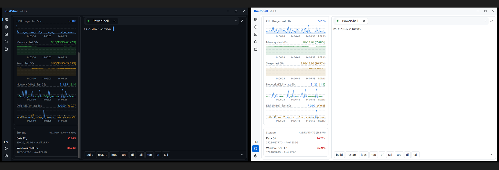
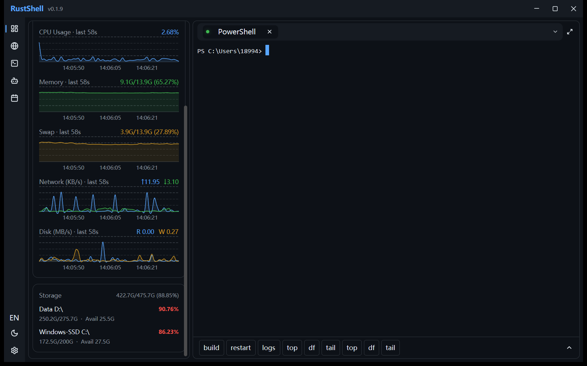
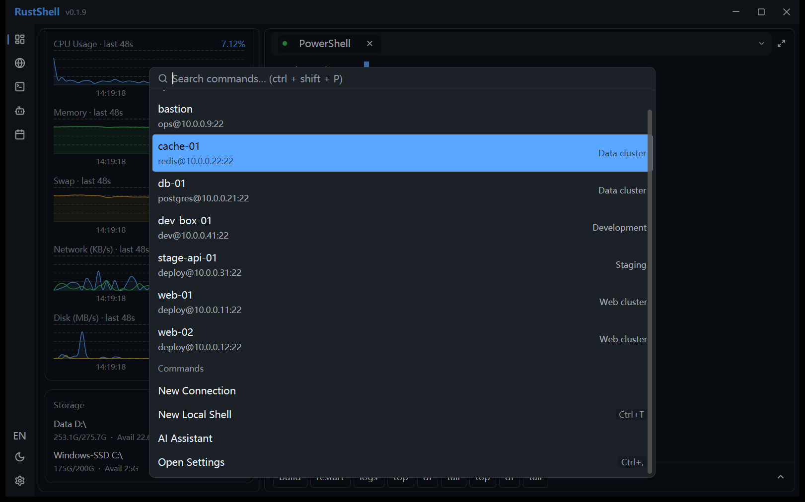
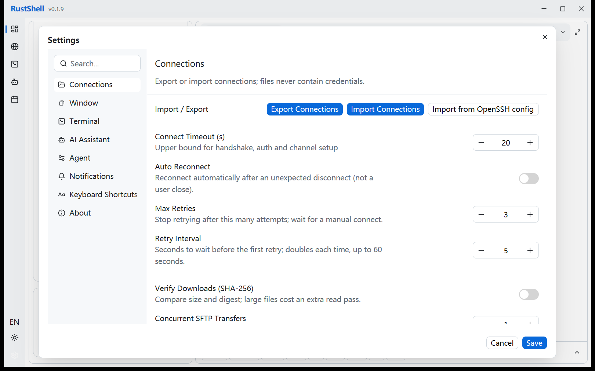

<div align="center">

# RustShell

**A cross-platform terminal / SSH / SFTP desktop client built with Rust + GPUI**

English · [简体中文](./README.md) · [Architecture](#architecture)

[](https://github.com/Yuxxxy/RustShell/actions/workflows/ci.yml)
[](https://github.com/Yuxxxy/RustShell/actions/workflows/release.yml)
[](https://www.rust-lang.org/)
[](./LICENSE)
[](https://github.com/Yuxxxy/RustShell)

</div>

---

## Screenshots

> Real screenshots captured on Windows 11. Connections, hostnames and IPs in the shots are demo data.
> Badges are self-hosted SVGs committed in this repo — no external image host involved.

**Dark / Light themes** — Dark / Light / Follow-system, a token-driven global re-skin



**System monitor overview** — CPU / memory / swap / network / disk sampled at 1 s, hand-drawn AreaChart trends



**Command palette and settings**

<p align="center">
  
  
</p>

<p align="center"><sub>Left: command palette (<code>Ctrl+Shift+P</code>) — quick connect and commands in one search · Right: Settings → Connections (import / export, timeouts, reconnection)</sub></p>

---

## What is RustShell

RustShell is a **cross-platform desktop terminal and server management tool** written in Rust + GPUI:

local terminal, SSH sessions, SFTP file transfer, quick commands, system monitoring and an optional AI

assistant — all inside one native window.

It uses no Electron / WebView. Terminal rendering is handled by the in-repo engine **`rustshell-terminal`**

(`alacritty_terminal` for VTE parsing + GPUI for GPU painting), so startup and scrolling stay at native

level (measured warm release start: 144–152 ms).

### Features

| Area | Capability |
| --- | --- |
| **Local terminal** | ConPTY / PTY sessions; multi-tab and split panes (right / bottom, sharing the current session or starting a new one); tab context menu with disconnect and in-place reconnect; async startup that never freezes the UI |
| **Terminal engine** | Full ANSI escape sequences; 256-color / 24-bit truecolor; bold, italic and underline variants; inverse video; three cursor shapes with blinking; bracketed paste; OSC 52 clipboard; GBK / Big5 / Shift_JIS transcoding |
| **Selection and search** | Drag-select / double-click a word / triple-click a line (copy on select); scroll wheel through history; `Ctrl+F` regex search with hit-to-hit jumping (scrollback included, wrapping around) |
| **SSH** | `russh` sessions (password / private key); `known_hosts` checks in OpenSSH format with first-use fingerprint confirmation; end-to-end timeouts (20 s handshake, 15 s each for auth and PTY) so it never hangs |
| **SFTP** | Remote directory browsing; upload / download; create directory; rename / delete; transfer queue with progress; shares one connection with the metrics service |
| **Connection manager** | Tree-style groups, double-click to connect, context menus, quick connect from the command palette |
| **Quick commands** | Group management, drag-and-drop ordering, move up / down, multi-line scripts sent line by line, risk interception with confirmation cards, pinned slots |
| **System monitoring** | Overview panel sampling CPU / MEM / SWP / network / disk at 1 s into a 300-point ring buffer; hover or expand for trends (hand-drawn AreaChart); turns red above 85%; sampling drops to 5 s when the window loses focus |
| **AI assistant** | OpenAI-compatible endpoints (including local gateways / Ollama), SSE streaming rendering, L1 Q&A + L2 command generation, three-level risk grading with interception, auto-approve allowlist, multi-provider fallback |
| **Appearance** | Dark / Light / Follow-system themes, system-following window decorations, Chinese and English UI |
| **Keybindings** | Record-to-rebind inside the settings panel (effective immediately), conflict detection, JSON import / export |
| **Observability** | Runtime logs (5 MB × 3 rotation + panic dump), audit logs for AI and quick commands (JSON Lines), one-click diagnostic bundle export |

### Security design (AI and command execution)

AI is an **optional** capability — with no provider configured it stays completely offline. Once enabled:

- **Upload scope you control:** only your input + metadata of the currently bound server + the last N lines of the active terminal (200 by default, adjustable from 10 to 2000). Passwords, private keys and other sessions are **never** uploaded
- **Redaction before sending:** password / token assignment patterns, `sk-` / `ghp-` / `AKIA` key literals, and IP regexes are filtered out; truncated at ≤8 KiB
- **Encrypted keys at rest:** Windows DPAPI, macOS Keychain, Linux Secret Service (`keyring`); the JSON only stores a reference
- **Three-level risk model:** queries run directly / state changes need confirmation / destructive ones (`mkfs`, `dd`, `rm -rf /`, fork bombs and the like) are blocked outright and cannot be allow-listed
- **Full auditing:** `agent-audit.log` records time, type, risk level, command and whether it ran — **interceptions are logged too**

---

## Architecture

Dependencies flow strictly one way: `app → shell → ui → core → platform`. The core layer has zero UI dependencies and is unit-testable on its own.

```
┌──────────────────────────────────────────────┐
│ app      binary entry: exe icon / version    │
├──────────────────────────────────────────────┤
│ shell    window assembly: titlebar, lifecycle│
│          keybinding registration             │
├──────────────────────────────────────────────┤
│ ui       screens and widgets, theme mapping, │
│          context menus                       │
├──────────────────────────────────────────────┤
│ core     session / SSH / SFTP / AI / metrics │
│          / i18n                              │
├──────────────────────────────────────────────┤
│ platform PTY, secrets, logging, paths, sys   │
└──────────────────────────────────────────────┘
        terminal — an independently evolving
        in-house terminal engine
```

| Crate | Description |
| --- | --- |
| [`app/`](./app) | Binary crate, includes the `cargo-packager` installer configuration |
| [`shell/`](./shell) | Window and titlebar assembly, embedded icon assets ([`shell/assets/icons/`](./shell/assets/icons)) |
| [`ui/`](./ui) | GPUI interface layer, ~42.7% covered by official `gpui-component` widgets, the rest self-built |
| [`core/`](./core) | Domain logic: session orchestration, SSH, SFTP, AI, metrics, quick commands, i18n |
| [`platform/`](./platform) | System abstraction: PTY, Keychain/DPAPI, logging, paths, sampling |
| [`terminal/`](./terminal) | `rustshell-terminal`: VTE parsing + grid + scrollback + GPU rendering |

---

## Keyboard shortcuts

| Action | Windows / Linux | macOS |
| --- | --- | --- |
| Command palette | `Ctrl+Shift+P` (`Ctrl+K` passes through to the shell when the terminal is focused) | `⌘K` (`⌘⇧P` when the terminal is focused) |
| New / close tab | `Ctrl+T` / `Ctrl+W` | `⌘T` / `⌘W` |
| Switch to tab 1–9 | `Ctrl+1`…`Ctrl+9` | `⌘1`…`⌘9` |
| Switch panel | pick it in the `Ctrl+Shift+P` palette | pick it in the `⌘⇧P` palette |
| Search in terminal | `Ctrl+F` | `⌘F` |
| Copy / paste in terminal | `Ctrl+Shift+C` / `Ctrl+Shift+V` | `⌘C` / `⌘V` |
| Split (right / bottom) | `Alt+R` / `Alt+D` | `⌥R` / `⌥D` |
| Settings | `Ctrl+,` | `⌘,` |

Every binding can be re-recorded and imported / exported in Settings → Keyboard Shortcuts. The design

deliberately avoids keys such as `Ctrl+K` and `Ctrl+L` that carry meaning in readline — those always pass

through to the shell when the terminal is focused.

---

## Configuration and data directories

`<config>` resolves per platform: `%APPDATA%` on Windows, `~/Library/Application Support` on macOS,

`~/.config` on Linux.

| File | Path | Description |
| --- | --- | --- |
| `settings.json` | `<config>/rustshell/` | Theme, terminal, connections, performance and AI settings; atomic writes |
| `quick_commands.json` | `<config>/rustshell/` | Quick commands (schema v2); atomic writes |
| `ai_config.json` | `<config>/rustshell/` | Provider config; **API keys are encrypted via the system keychain, the JSON stores only a reference** |
| `keymap.json` | `<config>/rustshell/` | User keybinding overrides |
| `known_hosts` | Platform OpenSSH path | Host fingerprints, OpenSSH format |
| `agent-audit.log` | `<config>/rustshell/` | AI / quick-command execution audit (JSON Lines) |
| `logs/rustshell.log` | `<config>/rustshell/logs/` | Runtime log, 5 MB × 3 rotation |

---

## Known limitations

- Running in a poor-GPU intranet environment may feel sluggish

---

## License

The original code in this project is licensed under the [Apache License 2.0](./LICENSE)
([full text](https://www.apache.org/licenses/LICENSE-2.0)).

---

## Acknowledgements

RustShell stands on the shoulders of these projects:

- [GPUI](https://gpui.rs) and [gpui-component](https://github.com/longbridge/gpui-component) — UI framework and component library
- [alacritty_terminal](https://github.com/alacritty/alacritty) — VTE parsing and terminal grid
- [portable-pty](https://github.com/wez/wezterm) — cross-platform PTY
- [russh](https://github.com/Eugeny/russh) / [russh-sftp](https://github.com/mpereira/russh-sftp) — SSH and SFTP
- [sysinfo](https://github.com/GuillaumeGomez/sysinfo) — system metrics collection
- [Lucide](https://lucide.dev) — icons
