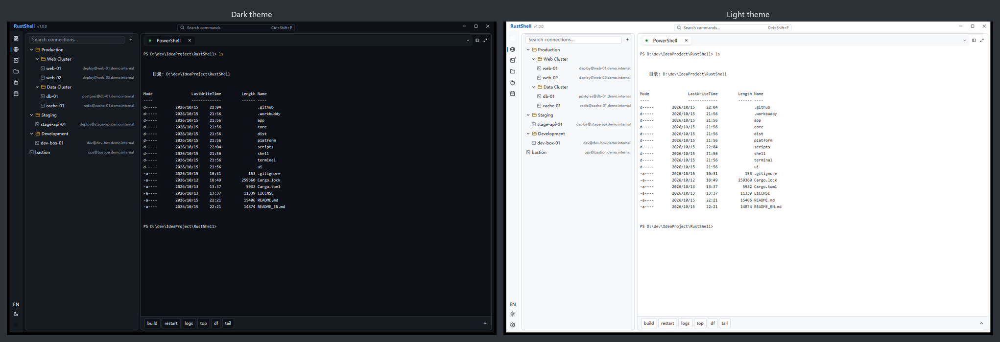
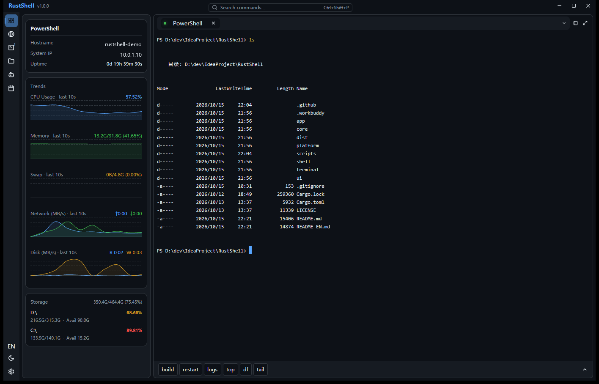
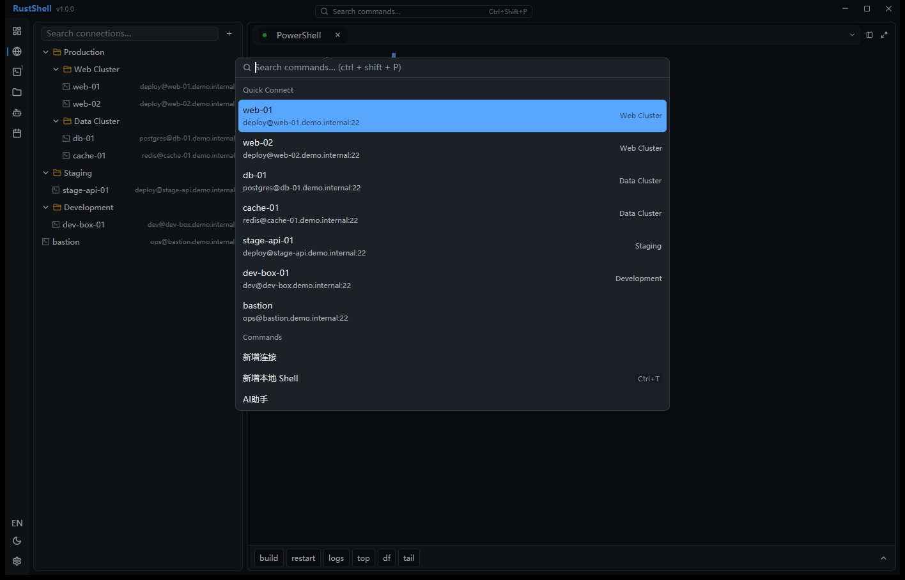
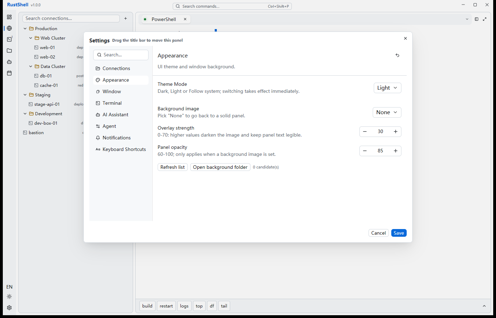

<div align="center">

# RustShell

**A cross-platform desktop terminal / SSH / SFTP client written in Rust + GPUI**

English · [简体中文](./README.md) · [Quick Start](#quick-start) · [Architecture](#architecture) · [Contributing](#contributing)

[](https://github.com/Yuxxxy/RustShell/actions/workflows/ci.yml)
[](https://github.com/Yuxxxy/RustShell/actions/workflows/release.yml)
[](https://www.rust-lang.org/)
[](./LICENSE)
[](https://github.com/Yuxxxy/RustShell)

</div>

---

## Screenshots

> Real screenshots captured on Windows 11. Connections, hostname and IPs shown are demo data.
> Badges are self-hosted SVGs committed in this repo — no external image host involved.

**Dark / Light themes** — Dark / Light / Follow-system, switched by a token-driven theme layer



**System monitor overview** — 1 s sampling of CPU / memory / swap / network / disk with a hand-drawn AreaChart



**Command palette and settings**

<p align="center">
  
  
</p>

<p align="center"><sub>Left: command palette (<code>Ctrl+Shift+P</code>) unifying quick-connect and commands · Right: Settings → Appearance (theme mode / background image / panel opacity)</sub></p>

---

## What is RustShell

RustShell is an open-source desktop terminal and server management tool built with Rust and
[GPUI](https://gpui.rs). It bundles a local terminal, SSH sessions, SFTP file transfer, quick-command
snippets, live system monitoring and an opt-in AI assistant into a single native-feeling window —
with its own terminal engine (`rustshell-terminal`) rather than an embedded web view.

No Electron, no WebView: terminal rendering is handled by the in-repo **`rustshell-terminal`** crate
(`alacritty_terminal` for VTE parsing + GPUI for GPU painting), so startup and scroll costs stay native
(measured warm release startup: 144–152 ms).

> **AI assistant:** not an external dependency but a self-built, safety-gated **domain-specific
> agent harness**. `runner` drives the control loop, `ai.rs` handles LLM communication, and
> `agent/` owns tool definitions plus the security/budget arbitration; the frontend (`ui/`)
> only consumes progress over the `AgentUiEvent` channel.
>
> **Status:** early-stage, actively developed. The current `gpui-pre-platform` 0.3.4 dependency
> ships **a Windows backend only**, so Windows 11 is the sole platform that actually runs today;
> macOS / Linux build scripts are in place but require upstream platform backends.

### Features

| Area | Capability |
| --- | --- |
| **Local terminal** | ConPTY / PTY sessions, multi-tab, split panes (right / bottom, optionally shared or fresh session), tab context menu with disconnect and in-place reconnect, async startup that never freezes the UI |
| **Terminal engine** | Full ANSI escape sequences, 256-color / 24-bit truecolor, bold-italic-underline variants, inverse video, three cursor shapes with blink, bracketed paste, OSC 52 clipboard, GBK / Big5 / Shift_JIS transcoding |
| **Selection & search** | Drag select / double-click word / triple-click line (copies on select), scrollback history, `Ctrl+F` regex search with hit navigation (into scrollback, wrapping around) |
| **SSH** | `russh` sessions (password / private key), `known_hosts` validation in OpenSSH format with first-use fingerprint confirmation, end-to-end timeouts (handshake 20s, auth and PTY 15s each) so it never hangs |
| **SFTP** | Remote directory browsing, upload / download, mkdir, rename / delete, transfer queue with progress, sharing one connection with the metrics service |
| **Connection manager** | Tree-structured groups, double-click to connect, context menus, command palette for quick connect |
| **Quick commands** | Group management, drag-and-drop ordering, move up / down, multi-line scripts sent line by line, risk interception with confirmation cards, pinned slots |
| **System monitoring** | Overview-panel CPU / MEM / SWP / network / disk sampled at 1s into a 300-point ring buffer; trend charts (self-drawn AreaChart), >85% turns red, sampling drops to 5s when the window loses focus |
| **AI assistant** | OpenAI-compatible endpoints (incl. local gateways / Ollama), SSE streaming, L1 Q&A + L2 command generation, three-tier risk classification with interception, auto-approve allowlist, multi-provider fallback |
| **Appearance** | Dark / Light / Follow-system themes, system-following window decorations, bilingual UI |
| **Keybindings** | Record-and-rebind inside the settings panel (applied instantly), conflict detection, JSON import / export |
| **Observability** | Runtime logs (5 MB × 3 rotation + panic to disk), AI and quick-command audit logs (JSON Lines), one-click diagnostic bundle export |

### Security design (AI and command execution)

The AI assistant is **optional** — with no Provider configured, RustShell is fully offline. Once enabled:

- **Controlled upload scope:** only your input + metadata of the currently bound server + the last N lines of the active terminal (200 by default, 10–2000 adjustable). Passwords, private keys and other sessions are **never** uploaded.
- **Redaction before sending:** password / token assignment patterns, `sk-` / `ghp_` / `AKIA` key literals, IP-address regexes; truncated at ≤8 KiB
- **Keys encrypted at rest:** Windows DPAPI, macOS Keychain, Linux Secret Service (`keyring`); the JSON only stores a reference
- **Three-tier risk model:** queries run directly / state changes require confirmation / destructive commands (`mkfs`, `dd`, `rm -rf /`, fork bombs, …) are blocked outright and cannot be allow-listed
- **Full auditing:** `agent-audit.log` records time, type, risk level, command and whether it executed — **blocked attempts are logged too**

---

## Quick Start

### Option 1: Download a prebuilt package

Grab a build from [Releases](https://github.com/Yuxxxy/RustShell/releases) or the Artifacts of
[Release Build](https://github.com/Yuxxxy/RustShell/actions/workflows/release.yml):

- Windows: `rustshell-<version>-windows-x64.zip` (portable, unzip and run) and `rustshell_<version>_x64-setup.exe` (NSIS installer, installs to the current user without admin rights)
- macOS: `rustshell-<version>-macos-x64-arm64.zip` (universal binary, runs on both Intel and Apple Silicon)

### Option 2: Build from source

Prerequisites:

- **Rust** stable ≥ 1.85 (`terminal/` uses edition 2024)
- **Windows:** Visual Studio 2022 Build Tools (MSVC linker and `rc.exe`)
- **macOS:** Xcode Command Line Tools (`xcode-select --install`)
- **Linux:** the system libraries GPUI needs (X11 / Wayland + fontconfig, depending on distro)

```bash
git clone https://github.com/Yuxxxy/RustShell.git
cd RustShell

# Development build
cargo build -p rustshell
cargo run -p rustshell

# Release build (thin LTO + strip, ~28 MB)
cargo build --release -p rustshell
```

Packaging (scripts live in [`scripts/`](./scripts); run them from the repo root):

```bash
# Windows: NSIS installer -> dist/packager/
./scripts/package-windows.sh

# macOS: universal binary + zip -> dist/
./scripts/build-macos.sh
```

> Both scripts do `cd "$(dirname "$0")/.."`, so they resolve the repo root and can be invoked from
> any working directory. The Windows installer lands in **`dist/packager/`**, because
> `out-dir = "../dist/packager"` in `app/Cargo.toml` resolves relative to `app/`, which is
> `cargo-packager`'s working directory.

Pushing a tag triggers CI builds for both platforms:

```bash
git tag v1.0.0 && git push origin v1.0.0
```

---

## Architecture

Dependencies flow strictly one way: `app → shell → ui → core → platform`. The core layer has zero UI
dependencies and is unit-testable on its own.

```
┌─────────────────────────────────────────────┐
│ app      binary entry: exe icon / version   │
├─────────────────────────────────────────────┤
│ shell    window assembly: titlebar, lifecycle│
│          keybinding registration             │
├─────────────────────────────────────────────┤
│ ui       screens and widgets, theme mapping, │
│          context menus                       │
├─────────────────────────────────────────────┤
│ core     session / SSH / SFTP / AI / metrics │
│          / i18n                              │
├─────────────────────────────────────────────┤
│ platform PTY, secret storage, logging, paths,│
│          system metrics                      │
└─────────────────────────────────────────────┘
        terminal — an independently evolving
        in-house terminal engine
```

| Crate | Description |
| --- | --- |
| [`app/`](./app) | Binary crate, includes the `cargo-packager` installer configuration |
| [`shell/`](./shell) | Window and titlebar assembly, embedded icon assets ([`shell/assets/icons/`](./shell/assets/icons)) |
| [`ui/`](./ui) | GPUI interface layer, ~42.7% covered by official `gpui-component` widgets, the rest self-built |
| [`core/`](./core) | Domain logic: session orchestration, SSH, SFTP, AI, metrics, quick commands, i18n |
| [`platform/`](./platform) | System abstraction: PTY, Keychain/DPAPI, logging, paths, sampling |
| [`terminal/`](./terminal) | `rustshell-terminal`: VTE parsing + grid + scrollback + GPU rendering |

The engine is plugged in through a thin adapter in the UI layer (`ui/src/terminal_view.rs`); SSH channels
are wrapped as PTY-like byte streams and fed to the engine, so local and remote sessions share one
rendering pipeline.

---

## Keyboard shortcuts

| Action | Windows / Linux | macOS |
| --- | --- | --- |
| Command palette | `Ctrl+Shift+P` (`Ctrl+K` passes through to the shell when the terminal is focused) | `⌘K` (`⌘⇧P` when the terminal is focused) |
| New / close tab | `Ctrl+T` / `Ctrl+W` | `⌘T` / `⌘W` |
| Switch to tab 1–9 | `Ctrl+1`…`Ctrl+9` | `⌘1`…`⌘9` |
| Switch panel | via the `Ctrl+Shift+P` command palette | same | `⌘⇧1`…`⌘⇧5` |
| Search in terminal | `Ctrl+F` | `⌘F` |
| Copy / paste in terminal | `Ctrl+Shift+C` / `Ctrl+Shift+V` | `⌘C` / `⌘V` |
| Split (right / bottom) | `Alt+R` / `Alt+D` | `⌥R` / `⌥D` | `⌘D` / `⌘⇧D` |
| Settings | `Ctrl+,` | `⌘,` |
| — (no dedicated shortcut) | toggle the three-state theme in Settings → Appearance | same | `⌘⇧L` |
| — (no dedicated shortcut) | open the AI panel via the activity bar or command palette | same | `⌘⇧A` |

All bindings can be re-recorded in Settings → Shortcuts and imported / exported. The design deliberately
avoids keys like `Ctrl+K` and `Ctrl+L` that carry meaning in readline — those always pass through to the
shell when the terminal is focused.

---

## Configuration and data directories

`<config>` resolves per platform: `%APPDATA%` on Windows, `~/Library/Application Support` on macOS,
`~/.config` on Linux.

| File | Path | Description |
| --- | --- | --- |
| `settings.json` | `<config>/rustshell/` | Theme, terminal, connections, performance, AI settings; atomic writes |
| `quick_commands.json` | `<config>/rustshell/` | Quick commands (schema v2); atomic writes |
| `ai_config.json` | `<config>/rustshell/` | Provider config; **API keys are encrypted via the system keychain, the JSON stores only a reference** |
| `keymap.json` | `<config>/rustshell/` | User keybinding overrides |
| `known_hosts` | Platform OpenSSH path | Host fingerprints, OpenSSH format |
| `agent-audit.log` | `<config>/rustshell/` | AI / quick-command execution audit (JSON Lines) |
| `logs/rustshell.log` | `<config>/rustshell/logs/` | Runtime log, 5 MB × 3 rotation |

---

## Roadmap

Near-term directions:

- OpenSSH `~/.ssh/config` import, connection profile migration import / export
- Full port-forwarding management (local / remote / SOCKS) and a tunnel list
- Automatic reconnect with exponential backoff, session resume
- IME support, session transcript logging, system tray
- Resumable SFTP transfers / drag-and-drop upload, remote file edit write-back
- CLI arguments and `ssh://` URL handling, auto-update

---

## Known limitations

- **Windows 11 is currently the only runnable platform**: `gpui-pre-platform` 0.3.4 ships a Windows Win32/DirectWrite backend only (and CI is pinned to `windows-latest` accordingly). macOS / Linux packaging scripts exist but need upstream platform backends before they can build
- Depends on the `gpui-pre` pre-release snapshot line and `gpui-component` 0.6.x; upstream APIs may still change
- Terminal selection, hyperlink recognition, OSC title / cwd tracking and similar details are still being polished
- Release artifacts are not code-signed; first launch on macOS requires manual approval (the scripts strip the quarantine attribute)

---

## Contributing

Issues and PRs are welcome. Before submitting, make sure this gate is green (same as CI):

```bash
cargo fmt --all -- --check
cargo clippy --workspace --all-targets -- -D warnings
cargo test --workspace --no-run     # compile all test targets (incl. integration tests)
cargo test --workspace --lib        # fast unit tests
```

A few conventions:

- **Spec before feature:** any functional change starts with a written spec and acceptance criteria
- **No hard-coded colors:** new UI goes through theme tokens
- **Every new string must be wired into i18n:** keep `core/src/i18n.rs` Chinese/English tables in sync; all static keys must be covered
- Prefer quantitative UI regression via `#[gpui::test] + VisualTestContext` (`debug_bounds` for geometry, `simulate_click` for real hit-testing) over screenshot comparison
- Commit messages may be in Chinese or English, but please explain **why**

---

## License

The original code in this project is licensed under the [Apache License 2.0](./LICENSE)
([full text](https://www.apache.org/licenses/LICENSE-2.0)).

`terminal/` (`rustshell-terminal`) is derived from
[`zortax/gpui-terminal`](https://github.com/zortax/gpui-terminal) (MIT OR Apache-2.0 dual license).
This repository distributes the **Apache-2.0** variant and, as upstream requires, retains its MIT copyright
notice and the full Apache-2.0 text — see [`terminal/LICENSE-MIT`](./terminal/LICENSE-MIT) and
[`terminal/LICENSE-APACHE`](./terminal/LICENSE-APACHE).

All dependencies have completed a license audit; the repository contains no GPL / AGPL dependencies.

---

## Acknowledgements

RustShell stands on the shoulders of these projects:

- [GPUI](https://gpui.rs) and [gpui-component](https://github.com/longbridge/gpui-component) — UI framework and component library
- [alacritty_terminal](https://github.com/alacritty/alacritty) — VTE parsing and terminal grid
- [portable-pty](https://github.com/wez/wezterm) — cross-platform PTY
- [russh](https://github.com/Eugeny/russh) / [russh-sftp](https://github.com/mpereira/russh-sftp) — SSH and SFTP
- [sysinfo](https://github.com/GuillaumeGomez/sysinfo) — system metrics collection
- [Lucide](https://lucide.dev) — icons
